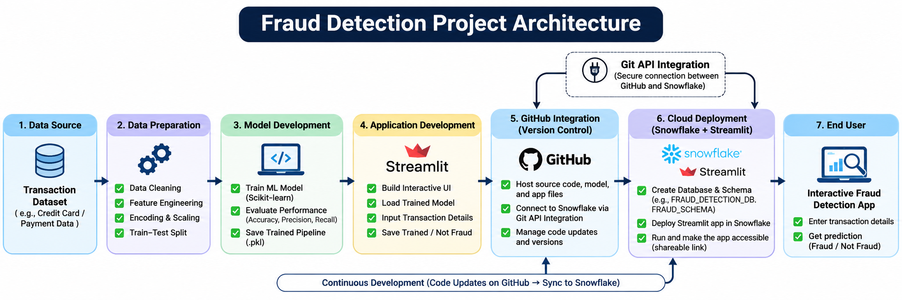
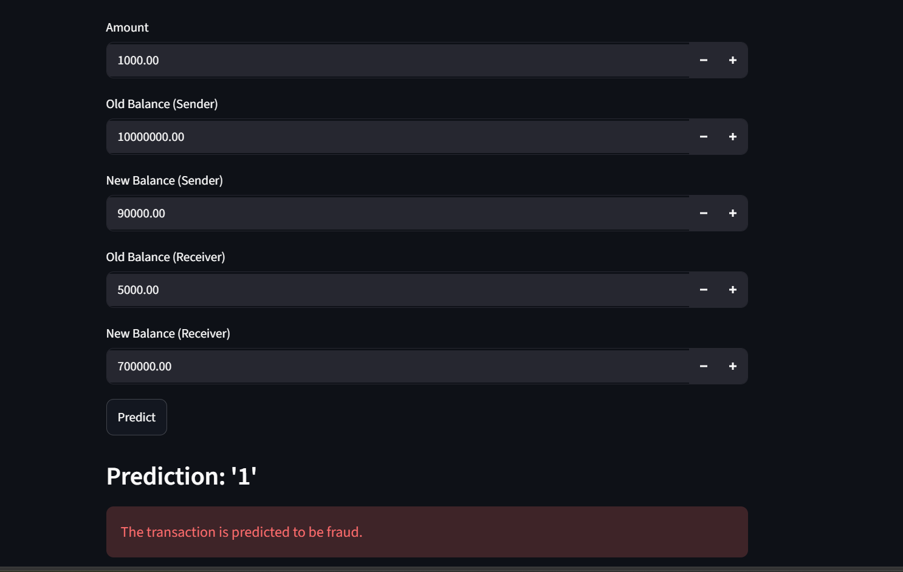

# Fraud Detection Using Machine Learning

**An end-to-end fraud detection prototype built with Python, scikit-learn, and Streamlit, with source code managed on GitHub and a Snowflake deployment.**

This project explores financial transaction data, builds a machine learning classifier, and provides an interactive application for screening individual transactions. It is a **learning and demonstration project**, not a production fraud prevention system.

## Project at a Glance

| Component | Details |
| --- | --- |
| **Problem** | Identify potentially fraudulent financial transactions |
| **Dataset** | 6,362,620 transactions; 8,213 labeled as fraud (about 0.13%) |
| **Model** | Class-weighted Logistic Regression in a scikit-learn pipeline |
| **Application** | Streamlit interface for single-transaction predictions |
| **Cloud platform** | Snowflake (Streamlit application) |
| **Version control** | GitHub; Snowflake Git API Integration configured |

## 1. Business Problem and Objective

Financial institutions process large numbers of transactions, while fraudulent transactions make up only a small fraction of the total. This imbalance makes fraud screening challenging: a model can achieve high overall accuracy but still generate too many false alarms or miss real fraud.

**Business question:** How can transaction type, transaction amount, and changes in sender and receiver balances help identify potentially fraudulent activity?

**Objective:** Analyze the transaction data, train and evaluate a supervised fraud classification model, and make its predictions accessible through a simple web interface.

## 2. Dataset

The analysis uses **6,362,620 transactions**, including **8,213 fraudulent** and **6,354,407 non-fraudulent** records.

| Feature | Description |
| --- | --- |
| `step` | Transaction time step |
| `type` | Transaction type: PAYMENT, TRANSFER, CASH_OUT, CASH_IN, or DEBIT |
| `amount` | Transaction amount |
| `nameOrig` | Sender identifier |
| `oldbalanceOrg` | Sender balance before transaction |
| `newbalanceOrig` | Sender balance after transaction |
| `nameDest` | Receiver identifier |
| `oldbalanceDest` | Receiver balance before transaction |
| `newbalanceDest` | Receiver balance after transaction |
| `isFraud` | Target label: 1 = fraud; 0 = legitimate |
| `isFlaggedFraud` | Pre-existing fraud flag |

**Dataset source:** [Fraud Detection Dataset on Kaggle](https://www.kaggle.com/datasets/amanalisiddiqui/fraud-detection-dataset).

The original dataset, used locally as `AIML Dataset.csv`, is about 471 MB and is **not included in this repository** because of GitHub's standard 100 MB file size limit. Download it from the source above to reproduce the notebook analysis, and review the source for its license and usage requirements.

## 3. Project Architecture



The architecture illustrates how transaction data moves through preprocessing and machine learning model development into the Streamlit interface. GitHub hosts the project files, and Snowflake provides a cloud environment for the deployed app. **Snowflake Git API Integration enables repository access; it does not by itself configure automatic deployment or CI/CD.**

## 4. Tools and Technologies

| Tool | Role in the project |
| --- | --- |
| **Python** | Data processing and application development |
| **Pandas / NumPy** | Data preparation and feature engineering |
| **Matplotlib / Seaborn** | Exploratory data visualization |
| **Scikit-learn** | Preprocessing, model training, and evaluation |
| **Joblib** | Saving and loading the fitted pipeline |
| **Streamlit** | Interactive fraud prediction application |
| **GitHub** | Source code storage and version control |
| **Snowflake** | Cloud-hosted Streamlit deployment and Git API Integration |

## 5. Machine Learning Workflow

1. **Explore the data:** Inspect transaction types, transaction amounts, fraud distribution, and balance patterns.
2. **Prepare the data:** Check data quality and account for the substantial class imbalance.
3. **Engineer features:** Create two balance-change variables:
   ```python
   balanceDiffOrig = oldbalanceOrg - newbalanceOrig
   balanceDiffDest = newbalanceDest - oldbalanceDest
   ```
4. **Preprocess model inputs:** Apply `StandardScaler` to numeric features and `OneHotEncoder` to transaction type.
5. **Train the model:** Fit `LogisticRegression(class_weight="balanced", max_iter=1000)` in a scikit-learn pipeline.
6. **Evaluate results:** Use a stratified 30% test split and report precision, recall, F1-score, accuracy, and a confusion matrix.
7. **Save and serve the pipeline:** Store the trained pipeline as `fraud_detection_pipeline.pkl` and load it in the Streamlit app.

## 6. Model Evaluation

The project notebook reports the following test-set results:

| Metric | Reported result |
| --- | ---: |
| Accuracy | 94.71% |
| Fraud precision | Approximately 2% |
| Fraud recall | Approximately 95% |
| Fraud F1-score | 0.04 |
| True positives | 2,334 |
| False negatives | 130 |
| False positives | 100,840 |

### What these results mean

The classifier identifies most labeled fraud cases in the test set (**high recall**), but many legitimate transactions are also flagged (**low precision**). Because fraud represents only about 0.13% of the data, **accuracy alone is not a reliable measure of fraud detection quality**.

**Next modeling priority:** Reduce false positives while maintaining useful recall, for example through threshold tuning, precision–recall analysis, PR-AUC, and comparison with alternative models.

## 7. Streamlit Fraud Detection Application

The Streamlit app allows a user to enter transaction details and request a prediction from the saved machine learning pipeline.

**Transaction prediction interface:**



The app is designed to demonstrate model inference on individual transactions. Predictions should be treated as experimental screening outputs, not final decisions about real financial transactions.

## 8. GitHub Integration and Snowflake Deployment

### GitHub integration

GitHub serves as the project's version-control and source-code repository. A **Git API Integration** was configured in Snowflake to authorize GitHub repository access as part of the project's cloud development workflow.

- Store and organize the notebook, application code, dependency information, and model artifact.
- Track changes using GitHub commits.
- Configure Snowflake to access an approved GitHub repository URL prefix.

**Important distinction:** Configuring the Git API Integration does not automatically link every app file or synchronize future GitHub commits. Any direct Git repository connection, pull/sync behavior, or automated CI/CD workflow must be configured separately.

### Snowflake deployment

The Streamlit application was deployed in Snowflake using a dedicated project database and schema.

| Snowflake resource | Project name |
| --- | --- |
| Database | `FRAUD_DETECTION_DB` |
| Schema | `FRAUD_SCHEMA` |
| Application | `FRAUD_DETECTION` |

This deployment demonstrates use of Snowflake's cloud workspace for hosting an interactive machine learning app. Opening a Snowflake-hosted Streamlit URL may require Snowflake authentication and appropriate permissions.

**Deployment URL:** _Add your Snowflake Streamlit application URL here._

**Public demo URL (optional):** _Add a Streamlit Community Cloud URL if you also publish a public version._

## 9. Repository Structure

```text
Fraud_Detection/
├── analysis_model.ipynb            # EDA, model training, and evaluation
├── fraud_detection.py             # Streamlit application
├── fraud_detection_pipeline.pkl   # Saved ML pipeline
├── requirements.txt               # Python dependencies
├── Fraud_detect_app_ss.png         # App screenshot
├── project_architecture.png        # Project architecture image
├── .gitignore                     # Local data and environment exclusions
└── README.md                      # Project documentation
```

> The image references above expect `Fraud_detect_app_ss.png` and `project_architecture.png` in the **repository root**. If either image is stored in a folder, update its Markdown path accordingly. The large CSV dataset is intentionally omitted from the repository.

## 10. Run the Application Locally

**1. Clone the repository**

```bash
git clone https://github.com/vishusinghsohi/Fraud_Detection.git
cd Fraud_Detection
```

**2. Create and activate a virtual environment**

```bash
python -m venv .venv
```

On Windows PowerShell:

```powershell
.\.venv\Scripts\Activate.ps1
```

On macOS or Linux:

```bash
source .venv/bin/activate
```

**3. Install the required libraries**

```bash
python -m pip install -r requirements.txt
```

**4. Launch Streamlit**

```bash
python -m streamlit run fraud_detection.py
```

Open the local URL shown in your terminal (usually `http://localhost:8501`), enter sample transaction information, and select **Predict**.

**Model compatibility:** Keep `fraud_detection_pipeline.pkl` alongside `fraud_detection.py`. Loading a joblib pipeline can fail or behave unpredictably if the deployed scikit-learn version differs from the version used during training. Pin compatible dependencies or retrain and export the pipeline in the target environment.

## 11. Reproduce the Notebook

1. Download the [dataset from Kaggle](https://www.kaggle.com/datasets/amanalisiddiqui/fraud-detection-dataset).
2. Save it as `AIML Dataset.csv` next to `analysis_model.ipynb`.
3. Install the notebook dependencies in a compatible Python environment.
4. Open `analysis_model.ipynb` and run the notebook cells.

## 12. Limitations and Future Improvements

- **False positives:** The present model has low fraud precision and may flag many legitimate transactions.
- **Evaluation:** Add PR-AUC, threshold analysis, and a dedicated validation strategy.
- **Model comparison:** Experiment with alternative classifiers and calibration techniques.
- **Deployment reliability:** Document exact dependency versions and verify prediction behavior after deployment.
- **Operations:** Add testing and, if needed, a clearly configured GitHub-to-Snowflake deployment workflow.
- **Intended use:** Keep the application as an educational prototype until it has been tested for real-world use, monitoring, data drift, and decision risks.

---

**Project repository:** [vishusinghsohi/Fraud_Detection](https://github.com/vishusinghsohi/Fraud_Detection)
